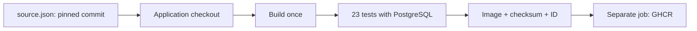

# Usage guide

[Português](guide.md) | [Back to the project](../README.en.md)

Run commands from the repository root.

## Flow



Pull requests run builds/tests with `contents: read`. Pushes to `main` and manual runs on `main` also publish after tests pass. Documentation-only changes do not trigger runs; workflow, script and `source.json` changes do. No schedule or automatic upstream change trigger is configured.

## Run and update the application

Open **Actions → Test and publish Docker Lab → Run workflow** on GitHub and select `main`.

```bash
gh workflow run ci.yml --repo tommmdl/github-actions-lab --ref main
gh run list --repo tommmdl/github-actions-lab
```

`source.json` pins the full application commit SHA. To update, change the revision to a reviewed `tommmdl/docker-lab` commit and open a PR. The workflow validates the repository/SHA format and tests that revision. Reruns keep using the same application revision until the pin changes.

## Testing and publication

The `test` job builds the API with OCI source/revision labels, starts Compose and runs the 23 upstream integration checks: CRUD, invalid input, persistence across recreation, database outage and recovery. It saves the image with `docker save`, an archive SHA-256 and the image ID.

The separate `publish` job downloads the artifact from the same run, verifies checksum and image ID, uses `docker load` and pushes without rebuilding. It does not check out source with write permissions. Actions are pinned by SHA. Runners are GitHub-hosted `ubuntu-24.04`.

Image: **`ghcr.io/tommmdl/docker-lab`**

Publication and anonymous pull confirmed in the [validated run](../docs/validation.en.md).

```bash
docker pull ghcr.io/tommmdl/docker-lab:latest
```

| Tag | Meaning |
| --- | --- |
| `run-<run_id>-<attempt>` | Unique tag per run attempt |
| `app-<full SHA>` | Latest build using this application commit |
| `latest` | Latest successful main publication |

Registry writers can overwrite tags. For reproducible consumption, use `ghcr.io/tommmdl/docker-lab@sha256:...` from the job summary or `publication` artifact. `app-...` may change on rebuild due to metadata/external dependencies.

## Permissions and credentials

Only the publication job receives `packages: write`; other jobs use `contents: read`. Login uses the ephemeral `GITHUB_TOKEN` through stdin. No PAT or manually configured secret is required for workflow publication. PRs cannot publish and do not use `pull_request_target`. Logout runs even after a failure.

The database secret uses a 0644 file inside a 0700 local directory on Linux, allowing the API UID to read the bind mount while restricting access through the host directory. The password is not copied into the image. Windows ACL behavior may differ.

GHCR package visibility is independent of repository visibility. New packages may start private. If needed, open package settings and make it public for anonymous pulls. Private-package consumers must authenticate with `read:packages`; never commit tokens or put them into Compose.

## Run the published image

Prerequisites: Docker Engine, Compose, Bash, Python 3 and curl on Linux/WSL; automatic local Compose installation supports x86_64. From this repository root:

```bash
bash scripts/prepare.sh
# Defaults use pinned digests; IMAGE_REF can select another API revision.
bash scripts/compose.sh -f compose.ghcr.yaml pull
bash scripts/compose.sh -f compose.ghcr.yaml up -d --wait --wait-timeout 180
```

Open http://localhost:8001. This Compose project uses its own name/volume and does not replace `docker-lab` on port 8000. PostgreSQL has no published host port. The API has no user authentication and binds only to localhost.

```bash
IMAGE_REF=ghcr.io/tommmdl/docker-lab@sha256:REPLACE_WITH_DIGEST \
  bash scripts/compose.sh -f compose.ghcr.yaml up -d --wait
bash scripts/compose.sh -f compose.ghcr.yaml down
```

`down` preserves the volume; **adding `-v` permanently deletes this demo environment's notes**. CI uses `down -v` only on its ephemeral runner to remove test data. Preparation preserves existing local passwords; changing the file does not rotate an initialized database password.

## Evidence and troubleshooting

[Actual validation](../docs/validation.en.md). Artifacts: `integration-evidence` (14 days), `tested-image` (3 days) and `publication` (30 days). Failure logs are collected too, but the JSON report exists only if tests reach completion. Only explicit files are uploaded; the database password is excluded.

- `permission_denied: write_package`: check `packages: write`, existing package linkage/access and account policies.
- Unauthorized pull: check package visibility and authenticate the consumer if required.
- `PermissionError` for `/run/secrets/db_password`: run the current `prepare.sh`; bind-mounted files must be readable by the API UID.
- Failed tests: inspect job logs and `integration-evidence`; publication is skipped.
- Download evidence: `gh run download RUN_ID --repo tommmdl/github-actions-lab -n integration-evidence`.

Limits: `linux/amd64` publication; no production deployment, signing or vulnerability audit. Archive checksums do not replace signed provenance. Review Action, script and Dockerfile changes before merging into main.

## References

- [Publishing images with GitHub Actions](https://docs.github.com/en/actions/tutorials/publish-packages/publish-docker-images)
- [GHCR authentication and permissions](https://docs.github.com/en/packages/working-with-a-github-packages-registry/working-with-the-container-registry)
- [Upstream application and tests](https://github.com/tommmdl/docker-lab)

The `publication` artifact now contains three lines: API, Bookworm PostgreSQL and Alpine PostgreSQL digests, in that order. Database tags use `postgres-`; `compose.ghcr.yaml` pins both images. Keep the historical `evidence/published-image.txt` as the original run record.
