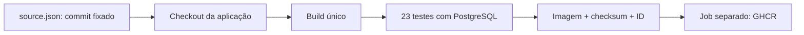

# Guia de uso

[English](guide.en.md) | [Voltar ao projeto](../README.md)

Execute os comandos a partir da raiz do repositório.

## Fluxo



Pull requests executam build e testes com `contents: read`. Pushes na `main` e execuções manuais na `main` também publicam após os testes. Mudanças só em documentação não disparam o pipeline; mudanças em workflows, scripts e `source.json` disparam. Não há execução agendada nem gatilho automático quando o repositório upstream muda.

## Executar e atualizar a aplicação

No GitHub, abra **Actions → Test and publish Docker Lab → Run workflow**, selecionando `main`.

```bash
gh workflow run ci.yml --repo tommmdl/github-actions-lab --ref main
gh run list --repo tommmdl/github-actions-lab
```

`source.json` fixa o SHA completo da aplicação. Para atualizar, altere a revisão para um commit revisado do `tommmdl/docker-lab` e abra um PR. O workflow valida formato/repositório e testa essa revisão. Sem edição do SHA, novas execuções continuam usando a mesma versão da aplicação.

## Testes e publicação

O job `test` constrói a API com os rótulos OCI de origem e revisão, inicia o Compose e executa os 23 testes de integração do upstream: CRUD, entrada inválida, persistência após recriação, falha do banco e recuperação. Salva imagem com `docker save`, SHA-256 do arquivo e ID da imagem.

O job `publish` recebe o artefato da mesma execução, confere checksum e ID, carrega com `docker load` e publica sem reconstruir. Não faz checkout de código com permissão de escrita. As Actions são fixadas por SHA. Os runners são `ubuntu-24.04` hospedados pelo GitHub.

Imagem: **`ghcr.io/tommmdl/docker-lab`**

Publicação e pull anônimo confirmados na [execução validada](../docs/validation.md).

```bash
docker pull ghcr.io/tommmdl/docker-lab:latest
```

| Tag | Significado |
| --- | --- |
| `run-<run_id>-<attempt>` | Tag única por tentativa de execução |
| `app-<SHA completo>` | Último build que usou esse commit da aplicação |
| `latest` | Última publicação bem-sucedida na main |

Tags podem ser sobrescritas por alguém com acesso ao registry. Para consumo reproduzível, use `ghcr.io/tommmdl/docker-lab@sha256:...` obtido no resumo do job ou artefato `publication`. `app-...` pode mudar em rebuilds por causa de metadados/dependências externas.

## Permissões e credenciais

Somente o job de publicação recebe `packages: write`; os demais usam `contents: read`. O login utiliza `GITHUB_TOKEN` efêmero via stdin. Nenhum PAT ou segredo manual é necessário para publicar a partir deste workflow. PRs não publicam e não usam `pull_request_target`. O logout executa mesmo após falhas.

O secret do banco usa arquivo 0644 dentro de diretório local 0700 no Linux, permitindo leitura pelo UID da API no bind mount sem expor a pasta a outros usuários do host. A senha não é copiada para a imagem. ACLs do Windows podem ter comportamento diferente.

A visibilidade de um pacote GHCR é independente da visibilidade do repositório. Pacotes novos podem iniciar privados. Se necessário, abra as configurações do pacote e habilite visibilidade pública para permitir pull anônimo. Para pacote privado, o consumidor precisa de autenticação com permissão `read:packages`; não coloque tokens no Compose ou no Git.

## Rodar a imagem publicada

Pré-requisitos: Docker Engine, Compose, Bash, Python 3 e curl (Linux/WSL; fallback do instalador Compose suporta x86_64). Na raiz deste repositório:

```bash
bash scripts/prepare.sh
# IMAGE_REF pode apontar para o digest publicado em vez de latest.
bash scripts/compose.sh -f compose.ghcr.yaml pull
bash scripts/compose.sh -f compose.ghcr.yaml up -d --wait --wait-timeout 180
```

Abra http://localhost:8001. Este projeto Compose usa nome/volume próprios e não substitui o ambiente do `docker-lab` na porta 8000. PostgreSQL não publica porta no host. A API permanece sem autenticação de usuários, restrita a localhost.

```bash
IMAGE_REF=ghcr.io/tommmdl/docker-lab@sha256:SUBSTITUA_PELO_DIGEST \
  bash scripts/compose.sh -f compose.ghcr.yaml up -d --wait
bash scripts/compose.sh -f compose.ghcr.yaml down
```

`down` preserva o volume; **adicionar `-v` apaga permanentemente as notas deste ambiente de demonstração**. No CI, `down -v` é usado somente no runner efêmero para remover dados de teste. `prepare.sh` preserva a senha local; alterar o arquivo não rotaciona credenciais de um banco já inicializado.

## Evidências e troubleshooting

[Validação real](../docs/validation.md). Artefatos: `integration-evidence` (14 dias), `tested-image` (3 dias) e `publication` (30 dias). Logs de falha também são coletados, mas o relatório JSON só existe se o teste chegar ao final. Apenas arquivos específicos são enviados; a senha do banco não é um artefato.

- `permission_denied: write_package`: confira `packages: write`, vínculo/permissões de um pacote preexistente e políticas da conta.
- `unauthorized` ao fazer pull: verifique a visibilidade do pacote e autentique o consumidor se necessário.
- `PermissionError` em `/run/secrets/db_password`: execute a versão atual de `prepare.sh`; arquivos bind-mounted precisam ser legíveis pelo UID da API.
- Testes falhando: consulte o log do job e `integration-evidence`; o job de publicação será pulado.
- Para baixar evidências: `gh run download RUN_ID --repo tommmdl/github-actions-lab -n integration-evidence`.

Limites: publicação em `linux/amd64`; sem deploy em produção, assinatura ou auditoria de vulnerabilidades. O checksum do artefato não substitui uma assinatura de proveniência. Alterações de Actions, scripts ou Dockerfile devem ser revisadas antes de entrar na main.

## Referências

- [Publicação de imagens no GitHub Actions](https://docs.github.com/en/actions/tutorials/publish-packages/publish-docker-images)
- [Autenticação e permissões do GHCR](https://docs.github.com/en/packages/working-with-a-github-packages-registry/working-with-the-container-registry)
- [Aplicação e testes originais](https://github.com/tommmdl/docker-lab)
